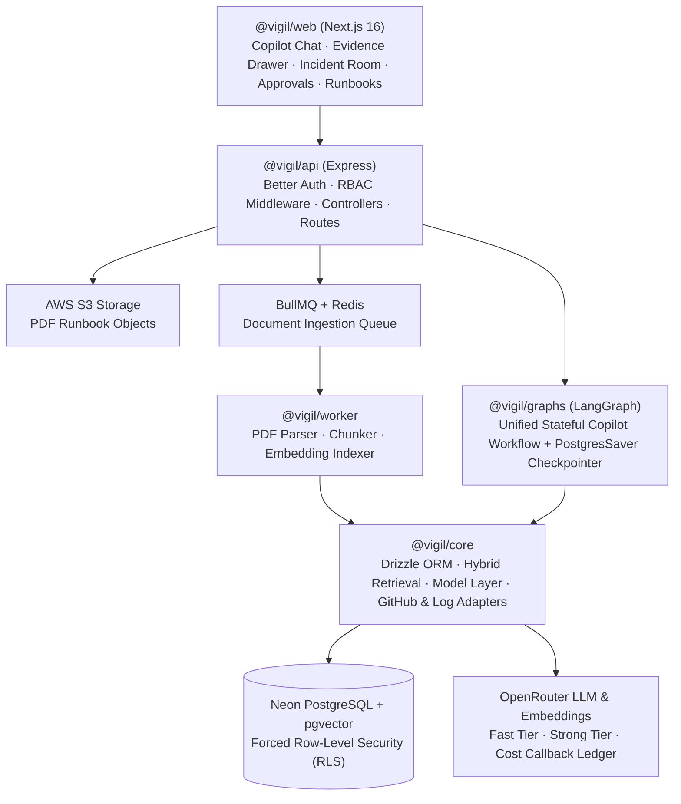
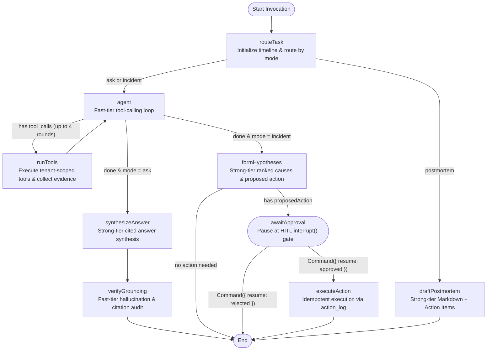

# Vigil — Autonomous Engineering Operations & Incident Copilot

**Vigil** is a multi-tenant AI Engineering Operations & Incident Copilot built to handle the full lifecycle of on-call engineering work: answering operational questions with grounded runbook citations, investigating live production incidents across runbooks, GitHub commits, and platform logs, gating remediation actions behind role-based human-in-the-loop (HITL) approvals, and drafting blameless postmortems.

---

## Table of Contents

1. [Product Capabilities](#1-product-capabilities)
2. [System Architecture & LangGraph Workflow](#2-system-architecture--langgraph-workflow)
3. [Monorepo Structure & Package Responsibilities](#3-monorepo-structure--package-responsibilities)
4. [Database Architecture & Multi-Tenant Security](#4-database-architecture--multi-tenant-security)
5. [Backend API Surface (Controllers & Routes)](#5-backend-api-surface-controllers--routes)
6. [Model Layer, Cost Ledger & Budget Governance](#6-model-layer-cost-ledger--budget-governance)
7. [Document Ingestion & Hybrid Retrieval Pipeline](#7-document-ingestion--hybrid-retrieval-pipeline)
8. [Frontend Workspace & Copilot Interface](#8-frontend-workspace--copilot-interface)
9. [Environment Configuration](#9-environment-configuration)

---

## 1. Product Capabilities

Vigil provides four integrated operational workflows inside a unified workspace:

1. **Ask Copilot (`ask` mode)** — Engineers ask operational or architectural questions and receive answers grounded in uploaded PDF runbooks, service catalog metadata, recent deployments, and past incident history, complete with verified source citations and confidence grading.
2. **Incident Investigation (`incident` mode)** — When an alert or production issue occurs, Vigil autonomously queries runbooks, inspects recent GitHub commits and deployment diffs, correlates similar past incidents and platform logs, ranks root-cause hypotheses with confidence scores, and proposes a concrete remediation action.
3. **Human-in-the-Loop Approvals (`awaitApproval` -> `executeAction`)** — Every proposed remediation action pauses execution at a PostgreSQL-checkpointed LangGraph interrupt gate and creates a pending approval record. Authorized operators (`admin` or `lead`) review the payload in the Approvals Inbox or inline chat panel to approve or reject execution, backed by an idempotent action log.
4. **Blameless Postmortem Generation (`postmortem` mode)** — Once an incident is investigated or resolved, Vigil synthesizes the incident timeline, root-cause hypotheses, and citations into a structured Markdown postmortem report with prioritized (`P0`, `P1`, `P2`) follow-up action items.

---

## 2. System Architecture & LangGraph Workflow

Vigil separates its Next.js frontend, Express API server, asynchronous BullMQ document ingestion worker, and shared core/graph packages across a `pnpm` monorepo.

### 2.1 High-Level Architecture

### 2.2 Unified LangGraph Topology (`@vigil/graphs`)

All three operational modes (`ask`, `incident`, and `postmortem`) run through a single compiled LangGraph state machine persisted with `PostgresSaver`:

### 2.3 Tenant-Scoped Agent Tools

Every tool in `@vigil/graphs` is bound to the caller's authenticated `orgId` at creation time (never passed by the model) and automatically records retrieved artifacts into graph state for citation tracking:

| Tool Name | Purpose | Backing Module in `@vigil/core` |
| :--- | :--- | :--- |
| **`search_runbooks`** | Hybrid semantic (`pgvector` cosine similarity) and full-text (`tsvector`) search with Reciprocal Rank Fusion (RRF) over indexed PDF documents. | `retrieval/search.ts` |
| **`lookup_service`** | Queries service tier, engineering owner, Slack channel, GitHub repository URL, and deployment platform from `ops_services`. | `ops/queries.ts` |
| **`get_recent_deploys`** | Combines deployment records from `ops_deploys` with live GitHub commits and file diffs fetched from the service's configured repository and branch. | `ops/queries.ts` & `ops/github.ts` |
| **`find_past_incidents`** | Searches historical incidents (`ops_past_incidents`) by service name and symptom keyword to surface prior root causes and resolution times. | `ops/queries.ts` |
| **`fetch_live_logs`** | Tails the most recent log entries for a service across configured cloud platforms (`cloud_run`, `aws_lambda`, `aws_ec2`, `render`, `vercel`, or `custom`). | `ops/logs.ts` |
| **`fetch_logs`** | Searches historical service logs over a configurable time window by severity level and keyword. | `ops/logs.ts` |
| **`web_search`** | Queries public vendor status pages, CVEs, and framework documentation via Firecrawl when internal telemetry is insufficient. | `config/firecrawl.ts` |
| **`web_scrape`** | Scrapes a specific public documentation or status URL into Markdown with untrusted-content wrapping. | `config/firecrawl.ts` |

---

## 3. Monorepo Structure & Package Responsibilities

| Workspace Path | Package Name | Responsibilities |
| :--- | :--- | :--- |
| **`apps/web`** | `@vigil/web` | Next.js 16 App Router frontend featuring the Vigil Copilot chat workspace, collapsible Evidence Drawer, Add Service modal, Incident Room, Approvals Inbox, Runbooks & Budget manager, Postmortem Editor, and Better Auth login/signup flows. |
| **`apps/api`** | `@vigil/api` | Express HTTP server organized into `controllers/`, `middleware/`, and `routes/`. Handles Better Auth sessions, RBAC role enforcement, S3 PDF uploads, BullMQ job enqueueing, and LangGraph execution/resumption. |
| **`apps/worker`** | `@vigil/worker` | Background BullMQ worker (`injestionQueue`) that downloads uploaded PDF runbooks from their public S3 URL, extracts and chunks text, generates 1536-dimensional embeddings, and stores searchable chunks in PostgreSQL. |
| **`packages/core`** | `@vigil/core` | Shared foundational library: Drizzle ORM schema and migrations, forced PostgreSQL RLS transaction wrappers (`withOrgContext`, `withUserContext`), OpenRouter model factory and cost ledger callbacks, hybrid retrieval queries, S3 & Firecrawl clients, GitHub commit fetcher, and multi-platform log adapters. |
| **`packages/graphs`** | `@vigil/graphs` | Unified LangGraph workflow (`VigilState`), `PostgresSaver` checkpointer setup, system prompts, tenant-bound tool definitions, and modular graph nodes (`routeTask`, `agent`, `runTools`, `synthesizeAnswer`, `verifyGrounding`, `formHypotheses`, `awaitApproval`, `executeAction`, `draftPostmortem`). |
| **`packages/shared`** | `@vigil/shared` | Shared TypeScript interfaces and constants across workspaces. |

---

## 4. Database Architecture & Multi-Tenant Security

Vigil uses Neon PostgreSQL with `pgvector` and Drizzle ORM. Every tenant-owned table enforces strict database-level isolation via `ENABLE ROW LEVEL SECURITY` and `FORCE ROW LEVEL SECURITY`.

### 4.1 Core Database Tables (`packages/core/src/db/schema.ts`)

| Table | Purpose | Isolation & Key Attributes |
| :--- | :--- | :--- |
| **`user`, `session`, `account`, `verification`** | Better Auth identity, session tokens, and credential storage. | Managed by Better Auth Drizzle adapter; automatic workspace provisioning hook on user creation. |
| **`orgs`** | Tenant workspaces created automatically on signup. | Primary tenant anchor (`id`, `name`). |
| **`members`** | Maps users to organizations with RBAC roles (`viewer`, `responder`, `lead`, `admin`). | Forced RLS (`org_isolation` and `members_self_select`). |
| **`documents`** | Metadata for uploaded PDF runbooks (`name`, `mimeType`, `size`, `storageKey`, `contentHash`, `status`). | Forced RLS; SHA-256 `contentHash` prevents duplicate uploads per org. |
| **`document_chunks`** | Parsed text chunks with `vector(1536)` embeddings and HNSW cosine index. | Forced RLS; cascades on parent document deletion. |
| **`ops_services`** | Service catalog storing `name`, `tier`, `owner`, `slackChannel`, `repoUrl`, `githubBranch`, `platform`, `logUrl`, and `platformConfig`. | Forced RLS; unique index on `(org_id, name)`. |
| **`ops_deploys`** | Deployment history (`service`, `sha`, `author`, `deployedAt`, `configDiff`, `status`). | Forced RLS. |
| **`ops_past_incidents`** | Historical incidents (`service`, `severity`, `summary`, `rootCause`, `resolution`, `timeToResolveMinutes`). | Forced RLS. |
| **`incidents`** | Active and resolved copilot incident investigations (`threadId`, `title`, `severity`, `status`, `openedBy`). | Forced RLS; links directly to LangGraph checkpoint `threadId`. |
| **`approvals`** | Pending and decided HITL remediation actions (`incidentId`, `action`, `decision`, `decidedBy`, `decidedAt`). | Forced RLS. |
| **`action_log`** | Idempotency ledger (`idempotencyKey` primary key, `orgId`, `result`) preventing duplicate external executions on retry. | Forced RLS. |
| **`model_usage` & `tenant_budgets`** | Append-only LLM token/cost ledger (`costUsd`, `promptTokens`, `completionTokens`) and per-org monthly USD caps (`monthlyLimitUsd`). | Forced RLS. |

---

## 5. Backend API Surface (Controllers & Routes)

The Express server in `apps/api/src/` separates route definitions (`src/routes/`), middleware (`src/middleware/`), and business logic (`src/controllers/`):

| Endpoint | Controller | Role Required | Description |
| :--- | :--- | :--- | :--- |
| **`ALL /api/auth/*`** | Better Auth Handler | Public | Handles email/password sign-up, sign-in, session management, and automatic org + budget provisioning. |
| **`GET /api/me`** | `getMeController` | `viewer+` | Returns the authenticated user's profile, active `orgId`, `orgName`, and RBAC `role`. |
| **`POST /api/docs/upload`** | `uploadDocController` | `responder+` | Validates PDF upload via Multer, deduplicates by SHA-256 hash, uploads to S3, saves a pending row, and enqueues BullMQ ingestion. |
| **`GET /api/docs`** | `listDocsController` | `viewer+` | Lists all documents for the active organization with their public S3 URLs and indexing status. |
| **`DELETE /api/docs/:id`** | `deleteDocController` | `lead+` | Deletes a document and cascades deletion to all associated vector chunks. |
| **`POST /api/ask`** | `askCopilotController` | `viewer+` | Runs the LangGraph workflow in `ask` mode and returns the grounded answer, citations, confidence, and execution timeline. |
| **`GET /api/incidents`** | `listIncidentsController` | `viewer+` | Lists all incidents for the organization ordered by most recent. |
| **`GET /api/incidents/:id`** | `getIncidentByIdController` | `viewer+` | Returns a single incident along with all associated approval records. |
| **`POST /api/incidents`** | `createIncidentController` | `responder+` | Creates an incident record and runs the LangGraph `incident` investigation up to the HITL approval gate. |
| **`POST /api/incidents/:id/postmortem`** | `generatePostmortemController` | `responder+` | Runs the LangGraph `postmortem` workflow for an incident and returns Markdown + prioritized action items. |
| **`GET /api/approvals`** | `listApprovalsController` | `viewer+` | Lists approvals for the organization (optionally filtered by `pending`, `approved`, or `rejected`). |
| **`POST /api/approvals/:id/decide`** | `decideApprovalController` | `lead+` | Records an `approved` or `rejected` decision and resumes the paused LangGraph thread via `Command({ resume })`. |
| **`GET /api/ops/services`** | `listServicesController` | `viewer+` | Lists all registered operational services for the organization. |
| **`POST /api/ops/services`** | `upsertServiceController` | `responder+` | Creates or updates a service (`name`, `tier`, `owner`, `slackChannel`, `repoUrl`, `githubBranch`, `platform`, `platformConfig`). |
| **`GET /api/ops/deploys`** | `listDeploysController` | `viewer+` | Returns recent database deploys merged with live GitHub commits and past incidents. |
| **`GET /api/ops/budget`** | `getBudgetController` | `viewer+` | Returns current monthly LLM token spend, remaining budget, and percentage used. |

---

## 6. Model Layer, Cost Ledger & Budget Governance

All LLM and embedding invocations are managed in `packages/core/src/model-layer/`:

1. **Two-Tier Model Routing (`getModel.ts`)** — `createTierModels` provisions a **Fast tier** (`openai/gpt-4o-mini` via OpenRouter) for tool calling, routing, and grounding checks, and a **Strong tier** (`anthropic/claude-3.5-sonnet` via OpenRouter) for answer synthesis, hypothesis ranking, and postmortem drafting.
2. **Pre-Flight Budget Gate (`handleLLMStart`)** — Before every LLM call, `assertWithinBudget(orgId)` checks the organization's current monthly spend in `model_usage` against `tenant_budgets.monthly_limit_usd` (default $250/month) and halts execution if the cap is exceeded.
3. **Automatic Cost Ledger (`handleLLMEnd`)** — A LangChain callback attached directly to each model instance extracts prompt and completion token counts after every call, calculates the USD cost from the pricing table, and inserts an audit row into `model_usage`.

---

## 7. Document Ingestion & Hybrid Retrieval Pipeline

1. **Deduplicated Upload** — When an operator uploads a PDF runbook (`POST /api/docs/upload` or via the chat attachment button), the API computes its SHA-256 content hash, checks `checkIfDocumentExists`, uploads the file to S3, and enqueues `{ documentUrl, documentId, orgId }` into the BullMQ `injestion` queue.
2. **Background Worker Processing** — `@vigil/worker` consumes the queue with exponential backoff retries (`attempts: 2`), downloads and parses the PDF via `pdf-parse`, splits text into overlapping chunks via `@langchain/textsplitters`, embeds all chunks in batches with `openai/text-embedding-3-small`, and marks the document `indexed` (or `failed` with an error message).
3. **Hybrid Search with RRF** — At query time, `hybridSearch` executes both dense vector similarity (`pgvector` cosine distance) and PostgreSQL full-text search (`plainto_tsquery`) inside the tenant's RLS context and fuses rankings via Reciprocal Rank Fusion (RRF).

---

## 8. Frontend Workspace & Copilot Interface

The Next.js 16 application (`apps/web`) provides a dark, minimal operational workspace:

- **Ask Vigil (Copilot Chat)** — Full-height conversational copilot supporting `Ask Copilot`, `Incident`, and `Postmortem` modes, severity selection (`SEV-1` to `SEV-3`), quick slash-command chips (`/runbooks`, `/deploys`, `/live-logs`, `/web`), direct `.pdf` runbook attachment uploads, collapsible execution traces, inline citation cards, interactive HITL approval cards, and a slide-over **Evidence Drawer** displaying sources, logs, and GitHub deploy diffs.
- **Add Service Modal** — Interactive configuration modal for registering services with GitHub repository auto-detection (`repoUrl` + `githubBranch`) and platform-specific settings (`Cloud Run`, `Lambda`, `EC2`, `Render`, `Vercel`, `Custom`).
- **Incident Room** — Displays active incident status steps (`Triage`, `Investigate`, `Rank causes`, `Awaiting approval`, `Resolve`), ranked root-cause hypotheses with confidence bars, evidence snippets, and live timeline notes.
- **Approvals Inbox** — Role-gated queue for reviewing proposed tickets, Slack status updates, and follow-up actions with one-click Approve or Reject execution.
- **Runbooks & Usage** — Displays live monthly LLM spend against the tenant budget cap, lists indexed PDF runbooks with live status indicators, and supports uploading or deleting runbooks.
- **Postmortems** — Interactive Markdown preview and editor that drafts blameless postmortems and action items from any investigated incident.

---

## 9. Environment Configuration

Configure the following environment variables in `.env`:

| Variable | Description |
| :--- | :--- |
| **`DATABASE_URL`** | Neon PostgreSQL connection string (with `pgvector` enabled). |
| **`REDIS_Host` / `REDIS_PORT` / `REDIS_Password`** | Redis connection details for BullMQ background worker queues. |
| **`OPENROUTER_API_KEY`** | API key for OpenRouter (powers Fast/Strong chat models and `text-embedding-3-small`). |
| **`BETTER_AUTH_SECRET` & `BETTER_AUTH_URL`** | Secret key and base URL (`http://localhost:4000`) for Better Auth session signing. |
| **`S3_REGION`, `S3_ACCESS_KEY`, `S3_SECRET_KEY`, `S3_BUCKET_NAME`** | AWS S3 credentials and bucket name for storing uploaded PDF runbooks. |
| **`FIRECRAWL_API_KEY`** | API key for Firecrawl web search and scraping tools. |
| **`GITHUB_TOKEN`** | Optional GitHub token for fetching commit history and file diffs from private repositories or with higher rate limits. |
| **`NEXT_PUBLIC_API_URL`** | Frontend base URL pointing to the Express API server (`http://localhost:4000`). |
