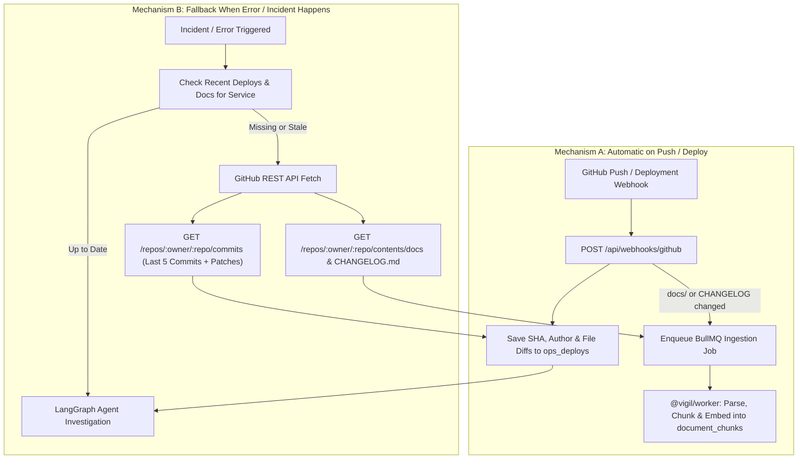

# Feature Specification: Automatic GitHub Commit, Deploy & Runbook Ingestion

## Overview
In a production engineering organization, operational outages are most frequently caused by recent code or configuration changes. To investigate incidents accurately, Vigil needs both:
1. **Proactive Ingestion (On Commit / Deploy):** Automatically capturing production deploy metadata, commit diffs, and updated runbooks (`docs/`, `CHANGELOG.md`) whenever code is merged or deployed.
2. **Reactive Fallback (On Error / Incident):** Automatically fetching the latest commits, file diffs, and repository documentation via the GitHub API if an incident or error occurs and recent deploy/documentation data is missing.

---

## 1. Key Folders & Files Tracked in a Production GitHub Repository

| Repository Path / Source | Purpose | Target Storage in Vigil |
|---|---|---|
| **`.github/workflows/*.yml`** | CI/CD pipelines, production deployment triggers, build/env configuration. | `ops_deploys.configDiff` |
| **`docs/` & `runbooks/`** (`docs/runbooks/`, `docs/adr/`, `README.md`) | Operational runbooks, architecture guides, escalation policies, rollback procedures. | `documents` & `document_chunks` (Hybrid Vector + FTS) |
| **`CHANGELOG.md` / `RELEASES.md`** | Human-readable release notes and breaking change summaries. | `documents` & `document_chunks` |
| **`infra/`, `k8s/`, `terraform/`, `Dockerfile`, `vercel.json`, `render.yaml`** | Infrastructure, container, scaling, and platform configuration changes. | `ops_deploys.configDiff` |
| **Git Commit Diff (`GET /repos/:owner/:repo/commits/:sha`)** | Exact modified files, line-level patches (`patch`), author, timestamp, and commit message. | `ops_deploys` (`sha`, `author`, `configDiff`, `deployedAt`) |

---

## 2. Database Schema Extension (`ops_services`)

Each service in `ops_services` links to its backing GitHub repository:

```ts
// packages/core/src/db/schema.ts
export const opsServices = pgTable("ops_services", {
  id: uuid("id").primaryKey().defaultRandom(),
  orgId: uuid("org_id").notNull().references(() => orgs.id, { onDelete: "cascade" }),
  name: text("name").notNull(),
  tier: integer("tier").notNull().default(1),
  owner: text("owner"),
  slackChannel: text("slack_channel"),
  repoUrl: text("repo_url"), // e.g. "https://github.com/acme-corp/checkout-service"
  githubBranch: text("github_branch").default("main"),
  platform: text("platform", { enum: DEPLOYMENT_PLATFORMS }),
  logUrl: text("log_url"),
  platformConfig: jsonb("platform_config").$type<PlatformConfig>(),
});
```

---

## 3. Architecture & Dual Ingestion Mechanism



### Mechanism A: Automatic Ingestion on Commit / Production Deploy
Triggered via a GitHub Webhook (`push` to `main` or `deployment_status`) at `POST /api/webhooks/github`:
1. **Record Deploy & Config Diff:**
   - Extracts the commit `sha`, `author`, `message`, and modified files (`added`, `modified`, `removed`).
   - Fetches the commit diff for infrastructure/config files (`.github/workflows/`, `Dockerfile`, `infra/`, `.env.example`, `package.json`) and inserts a row into `ops_deploys`.
2. **Auto-Ingest Updated Documentation:**
   - Checks if any modified file in the commit matches `docs/**`, `runbooks/**`, `CHANGELOG.md`, or `README.md`.
   - Uploads/syncs the updated document to S3, computes `contentHash` (`checkIfDocumentExists` skips unchanged files), and enqueues `{ documentUrl, documentId, orgId }` in `injestionQueue`.

### Mechanism B: On-Demand Fallback When an Error / Incident Happens
If an error or incident is opened for a service and no recent deploy or runbook exists in the database:
1. **Live Commit & Diff Fetch (`fetch_github_commits` tool):**
   - Reads `repoUrl` (e.g. `https://github.com/owner/repo`) from the `ops_services` row and extracts `{ owner, repo }`.
   - Calls `GET https://api.github.com/repos/{owner}/{repo}/commits?sha={branch}&per_page=5` and `GET https://api.github.com/repos/{owner}/{repo}/commits/{sha}`.
   - Saves the latest commits and file patches (`filename`, `status`, `additions`, `deletions`, `patch`) into `ops_deploys` and returns them directly to the LangGraph agent so `formHypotheses` can correlate stack traces with exact code changes.
2. **On-Demand Runbook Sync:**
   - Queries `GET https://api.github.com/repos/{owner}/{repo}/contents/docs` (and `CHANGELOG.md`) and ingests any missing documentation so the agent has immediate access to the repo's runbooks.

---

## 4. Environment Variables

```env
# Optional GitHub Personal Access Token or GitHub App Token (for private repos & higher rate limits)
GITHUB_TOKEN=ghp_xxxxxxxxxxxxxxxxxxxx
# Optional Webhook Secret for verifying x-hub-signature-256 on POST /api/webhooks/github
GITHUB_WEBHOOK_SECRET=whsec_xxxxxxxxxxxxxxxxxxxx
```
