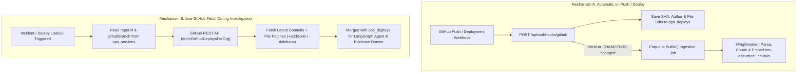

# Feature Specification: Automatic GitHub Commit, Deploy & Runbook Ingestion

## Overview
In a production engineering organization, operational outages are most frequently caused by recent code or configuration changes. To investigate incidents accurately, Vigil supports both:
1. **Proactive Ingestion (On Commit / Deploy):** Capturing production deploy metadata, commit diffs, and updated runbooks (`docs/`, `CHANGELOG.md`) whenever code is merged or deployed.
2. **Reactive Fallback (On Error / Incident):** Fetching the latest commits and file diffs via the GitHub REST API (`packages/core/src/ops/github.ts`) whenever an incident investigation or deploy lookup runs for a service with a registered `repoUrl`.

---

## 1. Key Folders & Files Tracked in a Production GitHub Repository

| Repository Path / Source | Purpose | Target Storage in Vigil |
| :--- | :--- | :--- |
| **`.github/workflows/*.yml`** | CI/CD pipelines, production deployment triggers, build/env configuration. | `ops_deploys.configDiff` |
| **`docs/` & `runbooks/`** (`docs/runbooks/`, `docs/adr/`, `README.md`) | Operational runbooks, architecture guides, escalation policies, rollback procedures. | `documents` & `document_chunks` (Hybrid Vector + FTS) |
| **`CHANGELOG.md` / `RELEASES.md`** | Human-readable release notes and breaking change summaries. | `documents` & `document_chunks` |
| **`infra/`, `k8s/`, `terraform/`, `Dockerfile`, `vercel.json`, `render.yaml`** | Infrastructure, container, scaling, and platform configuration changes. | `ops_deploys.configDiff` |
| **Git Commit Diff (`GET /repos/:owner/:repo/commits/:sha`)** | Exact modified files, line-level patches (`patch`), author, timestamp, and commit message. | `ops_deploys` (`sha`, `author`, `configDiff`, `deployedAt`) |

---

## 2. Service Catalog Schema (`ops_services`)

Each service in `ops_services` (`packages/core/src/db/schema.ts`) links to its backing GitHub repository and deployment platform:
- **`name`** — Unique service identifier within the organization (e.g., `checkout-api`).
- **`tier`** — Criticality tier (`1`, `2`, or `3`).
- **`owner`** & **`slackChannel`** — Owning engineering team and incident notification channel.
- **`repoUrl`** — Full GitHub repository URL (e.g., `https://github.com/org/checkout-api`).
- **`githubBranch`** — Production branch tracked for commits and diffs (defaults to `main`).
- **`platform`** & **`platformConfig`** — Target cloud platform (`cloud_run`, `aws_lambda`, `aws_ec2`, `render`, `vercel`, `custom`) and provider-specific identifiers.
- **`logUrl`** — Optional log tailing endpoint.

---

## 3. Architecture & Dual Ingestion Mechanism

### Mechanism A: Automatic Ingestion on Commit / Production Deploy
1. **Record Deploy & Config Diff:** Extracts the commit `sha`, `author`, `message`, and modified files (`added`, `modified`, `removed`) for infrastructure and application changes and stores them in `ops_deploys`.
2. **Auto-Ingest Updated Documentation:** Checks whether any modified file matches `docs/**`, `runbooks/**`, or `CHANGELOG.md`, deduplicates by SHA-256 `contentHash`, uploads to S3, and enqueues `{ documentUrl, documentId, orgId }` in `injestionQueue`.

### Mechanism B: Live GitHub Commit & Diff Fetching (`packages/core/src/ops/github.ts`)
Whenever the LangGraph agent invokes `get_recent_deploys` or the frontend requests `GET /api/ops/deploys`:
1. `fetchGitHubDeploysForOrg` looks up matching services in `ops_services` that have a configured `repoUrl`.
2. `fetchGitHubCommitsForRepo` parses `{ owner, repo }` from `repoUrl` and queries GitHub's REST API for the latest commits on `githubBranch` along with per-file diff statistics (`+additions -deletions`) and patches.
3. The live GitHub commit diffs are merged with database deploy records and surfaced both to the LangGraph investigator (`formHypotheses`) and the frontend **Evidence Drawer** (`Deploys` tab).
