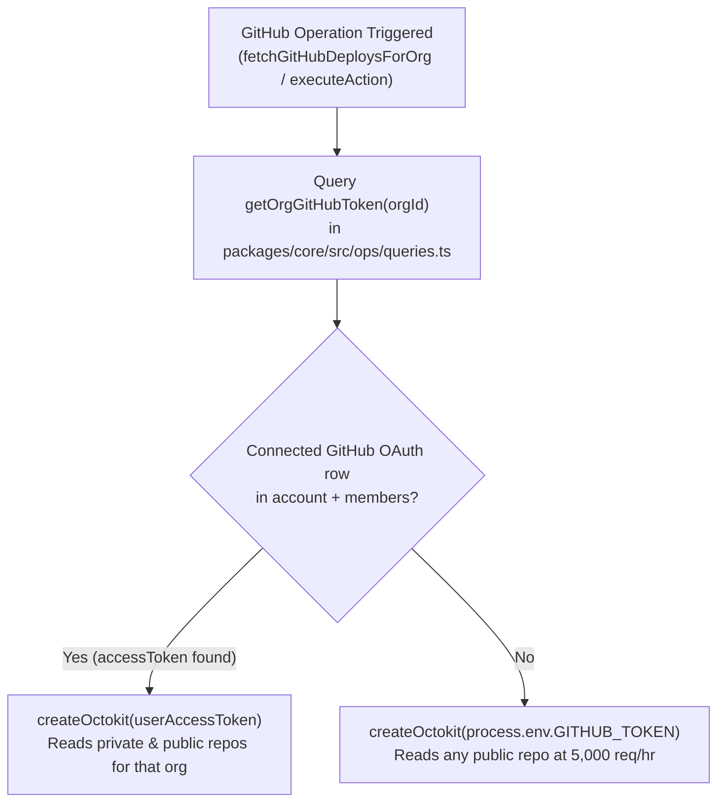

# Spec 01: Multi-Tenant Octokit & GitHub OAuth Integration

## 1. Overview

Vigil inspects recent GitHub commits, file-level diff patches, and repository runbooks during incident investigations and service deploy lookups. Because Vigil is a multi-tenant workspace where different engineering teams register their own services and repositories, GitHub API access must support both **public repositories** out of the box and **private repositories** belonging to any registered user.

---

## 2. Token Resolution Architecture

### 2.1 Two-Tier Credential Strategy
1. **Organization Member OAuth Token (`account.accessToken`)**
   - When a user signs in with GitHub or clicks **Connect GitHub** in **Settings → Profile**, Better Auth stores their OAuth `accessToken` (with `repo`, `read:user`, and `user:email` scopes) in the PostgreSQL `account` table (`provider_id = 'github'`).
   - `getOrgGitHubToken(orgId)` in `packages/core/src/ops/queries.ts` runs inside `withOrgContext(orgId)` and joins `account` with `members` to retrieve the workspace's connected GitHub token.
2. **Server Fallback Token (`process.env.GITHUB_TOKEN`)**
   - If a workspace has not linked a GitHub account yet, `createOctokit` in `packages/core/src/config/octokit.ts` falls back to `process.env.GITHUB_TOKEN`.
   - This allows Vigil to query any public repository on GitHub with authenticated rate limits (5,000 requests/hour instead of 60 requests/hour).

---

## 3. Core Octokit Operations (`packages/core/src/ops/github.ts`)

| Function | Octokit REST Method | Purpose |
| :--- | :--- | :--- |
| **`parseGitHubRepo`** | N/A (URL parser) | Extracts `{ owner, repo }` from full GitHub URLs (`https://github.com/owner/repo`) or shorthand slugs (`owner/repo`). |
| **`fetchGitHubCommitsForRepo`** | `octokit.rest.repos.listCommits` & `octokit.rest.repos.getCommit` | Fetches the latest commits on a service's configured branch (`githubBranch`) along with additions/deletions statistics and per-file diff patches. |
| **`fetchGitHubDeploysForOrg`** | Calls `fetchGitHubCommitsForRepo` per service | Resolves the org's GitHub token via `getOrgGitHubToken(orgId)`, queries all matching services with a `repoUrl` in `ops_services`, and merges their latest commits sorted by timestamp. |
| **`fetchGitHubFileContent`** | `octokit.rest.repos.getContent` | Reads and decodes base64 file contents (such as `README.md`, `CHANGELOG.md`, or `docs/` runbooks) from a service's repository branch. |
| **`createGitHubIssueForRepo`** | `octokit.rest.issues.create` | Opens a GitHub Issue on the target service repository when an operator approves a `create_ticket` remediation action. |

---

## 4. Better Auth & Frontend OAuth Flows

1. **Backend Auth Configuration (`apps/api/src/auth.ts`)**
   - Enables `account.accountLinking` for `github` so existing email/password users can link their GitHub account without creating a duplicate user record.
   - Configures `socialProviders.github` using `GITHUB_CLIENT_ID` and `GITHUB_CLIENT_SECRET` with `repo`, `read:user`, and `user:email` scopes.
2. **Identity Endpoint (`GET /api/me` in `apps/api/src/controllers/me.controller.ts`)**
   - Checks `getOrgGitHubToken(req.auth.orgId)` and returns `githubConnected: boolean` on the `user` object.
3. **Frontend Entry Points (`apps/web`)**
   - **Login & Signup Pages (`app/login/page.tsx`, `app/signup/page.tsx`)** — Provide a **Continue with GitHub** button calling `signInWithGitHub()` (`/api/auth/sign-in/social`).
   - **Workspace Settings (`components/SettingsView.tsx`)** — Displays a **GitHub Integration** card showing `Connected` or `Not connected` status and a **Connect GitHub** / **Reconnect GitHub** button calling `connectGitHubAccount()` (`/api/auth/link-social`).
