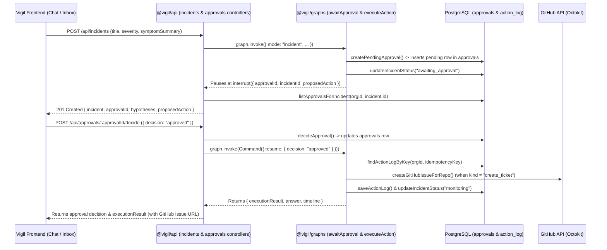

# Spec 02: Human-in-the-Loop Approvals & Real Action Execution

**Status:** Next up
**Fixes:** Issue 9 from [Spec 00](./00-repo-review-and-known-issues.md).

## 1. Overview

When Vigil investigates an incident in `incident` mode, the `formHypotheses` node ranks root causes and proposes a concrete remediation action (`ProposedAction` with `kind` set to `create_ticket`, `post_status`, or `schedule_followup`). Before any external write occurs, the workflow pauses at the `awaitApproval` node using LangGraph's `interrupt()` mechanism and records a pending row in the `approvals` table.

This specification defines the end-to-end `approvalId` handoff and the real external action execution inside `executeAction`.

---

## 2. Approval Lifecycle & `approvalId` Handoff

---

## 3. Required Implementation Details

### 3.1 Returning `approvalId` on Incident Creation (`apps/api/src/controllers/incidents.controller.ts`)
- Because `interrupt()` in `packages/graphs/src/nodes/awaitApproval.ts` suspends execution before `awaitApproval` returns its state update, `state.approvalId` is not yet populated on the state object returned by `graph.invoke()`.
- After `graph.invoke()` completes in `createIncidentController`, the controller queries `listApprovalsForIncident(orgId, incident.id)` and includes `approvalId: pendingApproval?.id ?? null` in the `POST /api/incidents` response payload.
- In `apps/web/components/chat/VigilCopilotChat.tsx` (and `apps/web/lib/api.ts`), the assistant turn stores `approvalId: data.approvalId` so clicking **Approve & Execute** or **Reject Action** in the chat panel calls `POST /api/approvals/:approvalId/decide` with the valid approval UUID.

### 3.2 Real External Execution in `executeAction` (`packages/graphs/src/nodes/executeAction.ts`)
1. **Idempotency Check**
   - Queries `findActionLogByKey(state.orgId, state.proposedAction.idempotencyKey)`. If a result already exists in `action_log`, returns the cached result immediately without re-running the external side effect.
2. **Action Dispatch by `kind`**
   - **`create_ticket`**:
     - Looks up the target service in `ops_services` via `getServiceByName(state.orgId, targetService)` (or `listOpsServices(state.orgId)` fallback) to obtain its `repoUrl`.
     - Resolves the workspace's GitHub token via `getOrgGitHubToken(state.orgId)`.
     - Calls `createGitHubIssueForRepo` with the proposed action title, rationale, evidence IDs, and severity label, storing `{ issueNumber, issueUrl }` in `executionResult`.
   - **`post_status`**:
     - Formats the status broadcast for the target Slack channel (`slackChannel`) and records the broadcast payload in `executionResult` (and posts to `SLACK_WEBHOOK_URL` if configured).
   - **`schedule_followup`**:
     - Records the follow-up task and owner metadata in `executionResult`.
3. **Persistence & State Transition**
   - Saves `executionResult` to `action_log` via `saveActionLog` and transitions the incident status to `monitoring` via `updateIncidentStatus`.

---

## 4. Related Security Rules ([Spec 07](./07-security-and-threat-model.md))
- **Use the approver's token for writes.** `createGitHubIssueForRepo` must run with the approving user's own GitHub token, not any member's token. If the approver hasn't connected GitHub, the action fails clearly and can be retried after connecting.
- **Check the action before approval.** Before a proposed action reaches the approval queue, code checks that its `kind` is allowed, its `target` is a registered service or channel in this org, and its `evidenceIds` refer to evidence collected in this run.
- **Audit everything.** Approval decisions and executed actions each write an `audit_events` row ([Spec 09](./09-feedback-and-observability.md)).

## 5. Non-goals
- Automatic rollbacks or infrastructure changes (for example changing Cloud Run traffic). The only external writes are tickets, status messages and follow-ups.
- Approving several actions at once.
- Editing a proposed action before approving. Possible later; for now it's approve or reject only.

## 6. Failure Cases

| Failure | Expected behavior |
| :--- | :--- |
| Approval ID doesn't exist or belongs to another org | `404`, graph not resumed. |
| Approval already decided | `409 Conflict`. The graph is not resumed a second time. |
| Service has no `repoUrl` for a `create_ticket` action | Action recorded as failed with reason "no repository configured". Incident stays `awaiting_approval` so it can be retried after fixing the service. |
| GitHub API fails during issue creation | Nothing is saved to `action_log` (so a retry can run). Error is returned to the UI and recorded in `audit_events`. |
| Same approval submitted twice at the same moment | Only one execution happens, thanks to the `action_log` primary key. The second request gets the cached result. |
| Rejected action | Graph ends, incident stays `investigating`, timeline records who rejected it. |

## 7. Acceptance Criteria
- [ ] `POST /api/incidents` returns a real `approvalId` whenever a proposed action exists.
- [ ] Clicking **Approve & Execute** in the chat panel succeeds (no 404) and shows the result.
- [ ] Approving a `create_ticket` action creates a real GitHub issue on the service's repo and shows the issue link in chat and in the Approvals Inbox.
- [ ] Approving the same request twice creates exactly one GitHub issue (covered by a test).
- [ ] A `viewer` or `responder` gets `403` when trying to approve.
- [ ] The incident moves to `monitoring` after a successful action.
