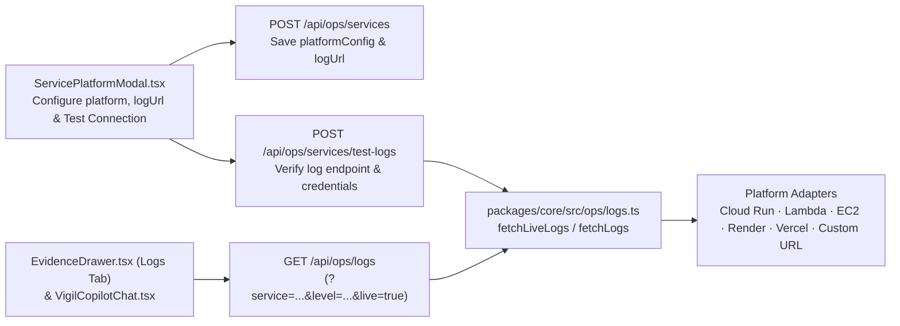

# Spec 03: Multi-Platform Live Logs & `logUrl` Integration

## 1. Overview

`packages/core/src/ops/logs.ts` implements multi-platform log adapters (`fetchLogs` and `fetchLiveLogs`) supporting Google Cloud Run, AWS Lambda, AWS EC2, Render, Vercel, and custom HTTP log endpoints (`logUrl`), with automatic fallback to correlated deploy/incident telemetry when external credentials are not configured.

While the LangGraph agent already invokes `fetch_live_logs` and `fetch_logs` as tools during investigations, this specification covers exposing those capabilities through the REST API and wiring them to the frontend **Add Service** modal and **Evidence Drawer**.

---

## 2. End-to-End Log Flow

---

## 3. Backend API Endpoints (`apps/api`)

| Method & Path | Controller | Role Required | Description |
| :--- | :--- | :--- | :--- |
| **`GET /api/ops/logs`** | `listLogsController` in `ops.controller.ts` | `viewer+` | Accepts optional query parameters `service`, `level` (`debug`, `info`, `warn`, `error`, `fatal`), `keyword`, `live` (`true` or `false`), and `limit`. Calls `fetchLiveLogs` when `live=true` or `fetchLogs` otherwise. |
| **`POST /api/ops/services/test-logs`** | `testServiceConnectionController` in `ops.controller.ts` | `responder+` | Validates a service's `repoUrl` (via Octokit) and/or `logUrl` + `platformConfig` before or after saving the service, returning `{ success, message, sampleCount }`. |

---

## 4. Frontend Integration (`apps/web`)

1. **`ServicePlatformModal.tsx` (`components/ops/ServicePlatformModal.tsx`)**
   - Expose the optional **Log endpoint (`logUrl`)** input field with platform-aware placeholders (`https://logging.googleapis.com/v2/entries:list`, `https://api.render.com/v1/logs`, etc.).
   - Wire the **Test connection** button to validate the repository URL and log configuration against the backend API instead of a local timer stub.
2. **`VigilCopilotChat.tsx` & `EvidenceDrawer.tsx` (`components/chat/`)**
   - When the **Evidence Drawer** opens, fetch `GET /api/ops/logs?live=true&limit=15` alongside `GET /api/ops/deploys`.
   - Normalize log levels (`ERROR`, `WARN`, `INFO`) and pass `liveLogs` into `EvidenceDrawer` so operators can inspect real-time log lines, timestamps, and trace IDs in the **Logs** tab.
