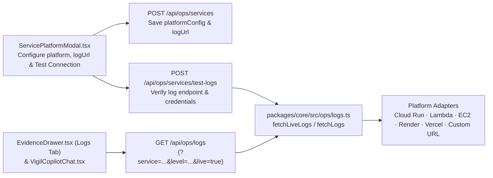

# Spec 03: Multi-Platform Live Logs & `logUrl` Integration

**Status:** Extended by [Spec 12: Multi-Cloud Integrations, Consistent Database Design & Live Logs](./12-multi-cloud-integrations-and-live-logs.md)

> **Note:** For the multi-tenant credential architecture (`org_integrations`), VPS push buffer (`ops_service_logs`), cons of the current design, and phased rollout across Cloud Run, GCP VM, AWS Lambda, AWS EC2, Render, Vercel, and Linux VPS, see **[Spec 12](./12-multi-cloud-integrations-and-live-logs.md)**.

## 1. Overview

`packages/core/src/ops/logs.ts` implements multi-platform log adapters (`fetchLogs` and `fetchLiveLogs`) supporting Google Cloud Run, AWS Lambda, AWS EC2, Render, Vercel, and custom HTTP log endpoints (`logUrl`), with automatic fallback to correlated deploy/incident telemetry when external credentials are not configured.

While the LangGraph agent already invokes `fetch_live_logs` and `fetch_logs` as tools during investigations, this specification covers exposing those capabilities through the REST API and wiring them to the frontend **Add Service** modal and **Evidence Drawer**.

---

## 2. End-to-End Log Flow

---

## 3. Backend API Endpoints (`apps/api`)

| Method & Path | Controller | Role Required | Description |
| :--- | :--- | :--- | :--- |
| **`GET /api/ops/logs`** | `listLogsController` in `ops.controller.ts` | `viewer+` | Accepts optional query parameters `service`, `level` (`debug`, `info`, `warn`, `error`, `fatal`), `keyword`, `live` (`true` or `false`), and `limit`. Calls `fetchLiveLogs` when `live=true` or `fetchLogs` otherwise. |
| **`POST /api/ops/services/test-logs`** | `testServiceConnectionController` in `ops.controller.ts` | `responder+` | Validates a service's `repoUrl` (via Octokit) and/or `logUrl` + `platformConfig` before or after saving the service, returning `{ success, message, sampleCount }`. |

---

## 4. Frontend Integration (`apps/web`)

1. **`ServicePlatformModal.tsx` (`components/ops/ServicePlatformModal.tsx`)**
   - Expose the optional **Log endpoint (`logUrl`)** input field with platform-aware placeholders (`https://logging.googleapis.com/v2/entries:list`, `https://api.render.com/v1/logs`, etc.).
   - Wire the **Test connection** button to validate the repository URL and log configuration against the backend API instead of a local timer stub.
2. **`VigilCopilotChat.tsx` & `EvidenceDrawer.tsx` (`components/chat/`)**
   - When the **Evidence Drawer** opens, fetch `GET /api/ops/logs?live=true&limit=15` alongside `GET /api/ops/deploys`.
   - Normalize log levels (`ERROR`, `WARN`, `INFO`) and pass `liveLogs` into `EvidenceDrawer` so operators can inspect real-time log lines, timestamps, and trace IDs in the **Logs** tab.

---

## 5. Security Notes ([Spec 07](./07-security-and-threat-model.md))
- **Log lines are untrusted.** Anyone who can send requests to a service can control what it logs. Wrap log output from `fetch_logs` and `fetch_live_logs` as untrusted data before it reaches the model, and cap each line's length.
- **Redact before sending.** Strip obvious secrets (bearer tokens, API keys, email addresses, card numbers) from log lines before they reach the model or the browser.
- **Keep provider credentials server-side.** Platform API keys stay in environment variables or encrypted org settings and are never returned to the browser. The Add Service modal stores only the name of a secret (for example `RENDER_API_KEY`), not its value.
- **Block internal URLs.** A custom `logUrl` is called from the server, so block private and internal addresses (localhost, `169.254.x.x`, `10.x.x.x`, etc.) to prevent server-side request forgery.

## 6. Non-goals
- Storing logs long-term in Vigil (Vigil reads from the provider when needed).
- Building a full log search UI. The Evidence Drawer shows recent, relevant lines only.
- Metrics and traces from providers (logs only for now).

## 7. Failure Cases

| Failure | Expected behavior |
| :--- | :--- |
| Provider credentials missing | Fall back to correlated deploy and incident entries (current behavior), clearly labeled as "derived", not real logs. |
| Provider returns an error | `GET /api/ops/logs` returns the error message and the platform name. The drawer shows "Logs unavailable: …" instead of an empty list. |
| `logUrl` points to a private or internal address | Rejected on save and at test time with a clear error. |
| Provider is slow | Time out after a few seconds and show partial results or an error, so the drawer doesn't hang. |

## 8. Acceptance Criteria
- [ ] `GET /api/ops/logs?service=X&live=true` returns normalized entries for at least Cloud Run, Render and a custom `logUrl`.
- [ ] The Add Service modal shows the `logUrl` field, and **Test connection** gives a real success or failure from the backend.
- [ ] The Evidence Drawer **Logs** tab shows live entries with level, timestamp and trace ID.
- [ ] Log output given to the agent is wrapped as untrusted and length-capped (covered by a test).
- [ ] A `logUrl` pointing to localhost or a private network address is rejected (covered by a test).
