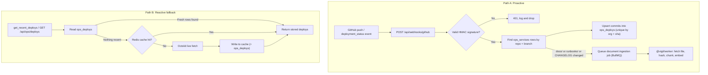

# Spec 05: GitHub Webhooks & Proactive Ingestion

**Status:** Planned
**Fixes:** Issue 1 (replaces the deleted `features/` doc) and Issue 6 (GitHub call volume) from [Spec 00](./00-repo-review-and-known-issues.md).

---

## 1. Problem

Today Vigil only learns about code changes **reactively**. Every time the agent or the Evidence Drawer needs recent deploys, `fetchGitHubDeploysForOrg` calls the GitHub API live. This has three problems:

1. **Slow and expensive:** up to 33 GitHub requests per lookup, repeated on every drawer open and every agent tool call.
2. **No history:** commits are never saved, so `ops_deploys` stays empty unless someone fills it by hand. Past deploys can't be compared over time.
3. **Stale runbooks:** when a team updates `docs/runbooks/*.md` in their repo, Vigil doesn't know until someone uploads a PDF manually.

Most outages are caused by recent changes, so Vigil should record each change **when it happens**, not search for it during an incident.

---

## 2. Solution Overview

Two ingestion paths that work together:

| Path | Trigger | What it does | When it is used |
| :--- | :--- | :--- | :--- |
| **A. Proactive (webhooks)** | GitHub sends `push` and `deployment_status` events to Vigil | Saves commit metadata and diffs to `ops_deploys`. Queues changed docs for ingestion. | Normal operation. Covers most reads. |
| **B. Reactive (live fetch with cache)** | Agent tool or Evidence Drawer needs deploys and nothing recent is stored | Calls Octokit (existing `fetchGitHubCommitsForRepo`) and caches the result in Redis | Fallback when webhooks are not set up yet, or for the newest few minutes |

---

## 3. Webhook Endpoint Design

### 3.1 Endpoint
- **Route:** `POST /api/webhooks/github` in a new `webhooks.controller.ts` and `routes/webhooks.ts`.
- **Auth:** No session. The request is authenticated only by its signature.
- **Raw body:** The route must read the raw request body **before** `express.json()` parses it, because the signature is computed over the exact bytes GitHub sent. Mount it next to the Better Auth handler in `apps/api/src/index.ts`, using a raw body parser for this route only.

### 3.2 Signature verification
1. GitHub signs every delivery with HMAC SHA-256 using the webhook secret and sends the result in the `X-Hub-Signature-256` header.
2. Vigil recomputes the HMAC over the raw body and compares the two values with a **constant-time comparison** to avoid timing attacks.
3. A missing or mismatched signature returns `401`, and the delivery is dropped without any database write.
4. **Per-org secrets:** each org gets its own webhook secret. It is stored encrypted and shown once in the Add Service modal. A leaked secret then affects only one tenant. The URL includes an org identifier (for example `/api/webhooks/github/:orgWebhookId`) so the right secret can be found before verifying.

### 3.3 Events handled

| GitHub event | Action |
| :--- | :--- |
| `ping` | Return `200` so the GitHub UI shows the webhook as healthy. |
| `push` | For each commit on the tracked `githubBranch`, upsert a row into `ops_deploys` (`sha`, `author`, `message`, `deployedAt`, `configDiff` with changed files and diff stats). Fetch per-file patches with one `getCommit` call per commit, capped at the 10 most recent. |
| `deployment_status` | Update the matching `ops_deploys.status` (`success`, `failed`, `rolled_back`). This gives the agent real deploy outcomes, not just commits. |
| Anything else | Return `202` and ignore. |

### 3.4 Duplicate and retry safety
- GitHub may deliver the same event more than once. Store the `X-GitHub-Delivery` ID in a small `webhook_deliveries` table and skip IDs already processed.
- Add a unique index on `ops_deploys (org_id, service, sha)` so re-processing a commit updates the row instead of inserting a duplicate.

### 3.5 Respond fast, work later
GitHub expects a reply within about 10 seconds. The controller only verifies the signature, records the delivery ID and queues a BullMQ job (`githubEventQueue`). The worker then makes the Octokit calls and the database writes.

---

## 4. Automatic Runbook Ingestion

When a `push` changes files matching any of these paths, the worker queues them for ingestion:
- `docs/**/*.md`
- `runbooks/**/*.md`
- `CHANGELOG.md`
- `README.md` (root only)

**Steps:**
1. Fetch the file with `fetchGitHubFileContent` at the pushed commit SHA.
2. Compute the SHA-256 `contentHash`. If an identical document already exists for the org, skip it. This reuses the existing duplicate check.
3. Save a `documents` row with `sourceUrl` set to the GitHub file URL, so citations link straight to the source file.
4. Run the existing chunk and embed pipeline. Markdown needs a markdown text splitter instead of the PDF parser.
5. **Deleted files:** mark the matching document as archived so it stops appearing in search results.

---

## 5. Reactive Fallback with Caching

Until webhooks are set up for a repo, the live path stays, but with caching:

| Data | Cache key | How long to cache | Reason |
| :--- | :--- | :--- | :--- |
| Commit list for a branch | org + repo + branch | 60 seconds | New commits can land at any time, so keep this short. |
| Commit detail (files and patches) | repo + sha | 7 days | A commit's contents never change once it exists. |

Redis is already running for BullMQ, so no new infrastructure is needed.

---

## 6. Setup Experience

In the Add Service modal (`ServicePlatformModal.tsx`), after the user saves a service with a `repoUrl`:
1. Show the webhook URL and the per-org secret (secret shown once, with a copy button).
2. List the events to enable in GitHub: `push` and `deployment_status`.
3. Show the last delivery time and status (from `webhook_deliveries`) so users can tell the webhook is working.

With a GitHub App ([Spec 11](./11-integrations-roadmap.md)), webhooks are configured automatically and this manual step goes away.

---

## 7. Non-goals
- Processing pull request review comments or CI check-run logs.
- Backfilling full repository history. Only new events, plus the most recent 10 commits on first setup.
- Supporting GitLab or Bitbucket (possible future spec).

## 8. Failure Cases

| Failure | Expected behavior |
| :--- | :--- |
| Invalid or missing signature | `401`, nothing written, the attempt is logged. |
| Repo in the event matches no registered service | `202`, delivery recorded as "unmatched" so it can be debugged. |
| Octokit call in the worker fails (token revoked, rate limit) | Job retries with backoff. After the last attempt, the commit is saved with basic data from the event payload (no patches) and the error is recorded. |
| Same delivery sent twice | Second copy is skipped based on `X-GitHub-Delivery`. |
| Huge push (for example 500 commits) | Only the newest 10 commits get detailed diffs. The rest are saved with basic metadata. |

## 9. Acceptance Criteria
- [ ] A signed `push` event creates `ops_deploys` rows with SHA, author, message, timestamp and changed-file stats, under the correct `org_id`.
- [ ] An unsigned or wrongly signed request returns `401` and writes nothing (covered by an automated test).
- [ ] Sending the same delivery twice creates no duplicate rows (covered by a test).
- [ ] Changing `docs/runbooks/x.md` in a push makes that runbook searchable through `search_runbooks` within 2 minutes, with a citation linking to the GitHub file.
- [ ] With webhooks active, `GET /api/ops/deploys` makes **zero** GitHub API calls for data already stored.
- [ ] Without webhooks, repeated `GET /api/ops/deploys` calls within 60 seconds make at most one commit-list call per repo.
