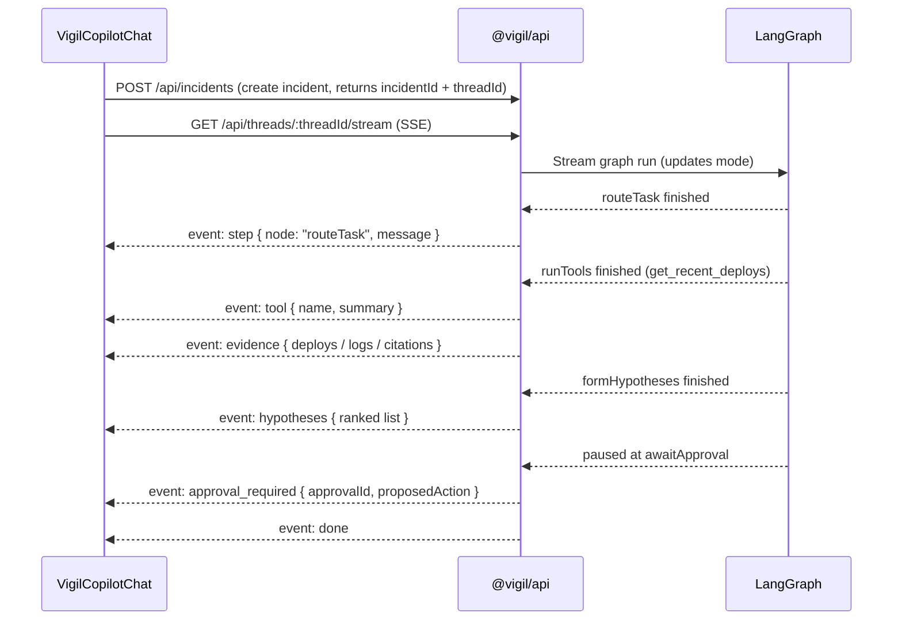

# Spec 08: Streaming Investigations (Live Timeline)

**Status:** Planned

---

## 1. Problem

`POST /api/incidents` and `POST /api/ask` wait until the whole graph finishes, or reaches the approval pause, before sending anything back. An incident investigation can involve up to 4 tool rounds plus a strong-model hypothesis step, which often means **30–60 seconds of a "Working on it…" spinner**. During an outage, that wait feels broken, and users may click again or refresh, starting duplicate investigations.

The graph already records every step in `state.timeline`. We just don't send those steps to the user as they happen.

---

## 2. Solution

Stream graph progress to the browser using **Server-Sent Events (SSE)**. SSE is one-way (server to browser), runs over normal HTTP, works with cookies and the existing CORS setup, and reconnects automatically. That's a better fit than WebSockets for this use case.

---

## 3. Event Types

| Event | When it is sent | Payload (described, not code) |
| :--- | :--- | :--- |
| `step` | A graph node finishes | Node name, a short human-readable message, timestamp. |
| `tool` | A tool call starts or finishes | Tool name, safe argument summary (no secrets), result count, duration. |
| `evidence` | New citations, deploys or log lines are collected | The new items only, so the Evidence Drawer can fill in live. |
| `token` | (Optional, ask mode) The final answer is being generated | Text chunks of the answer, for a typing effect. |
| `hypotheses` | `formHypotheses` finishes | Ranked causes with confidence. |
| `approval_required` | Graph pauses at `awaitApproval` | `approvalId` (this also fixes Spec 02's handoff problem), proposed action. |
| `error` | Any node fails | Safe error message (no stack traces), whether retry is possible. |
| `done` | Run finished or paused | Final status. |

---

## 4. Backend Design

1. **Split "start" from "run".** `POST /api/incidents` creates the incident and returns `incidentId` and `threadId` right away. The graph run starts in the background (a BullMQ job, so it survives API restarts) or when the stream is opened.
2. **Stream endpoint.** `GET /api/threads/:threadId/stream` checks the session and confirms the thread belongs to the caller's org, then forwards graph progress as SSE events. LangGraph can stream per-node updates directly from a graph run.
3. **Reconnect support.** Every event carries an increasing ID. If the browser reconnects with the last ID it saw, the server replays missed events from the saved checkpoint and timeline, then continues live.
4. **Keep-alive.** Send a comment line every 15 seconds so proxies and load balancers don't close idle connections.
5. **Tenant safety.** Opening a stream for another org's thread returns `404` (not `403`, to avoid revealing that the thread exists).

---

## 5. Frontend Design

1. `VigilCopilotChat.tsx` opens an `EventSource` after creating the incident or asking a question.
2. `AgentTimelineTrace` shows steps as they arrive, with the current step animated.
3. The Evidence Drawer badge count goes up live as `evidence` events arrive.
4. When `approval_required` arrives, the approval card appears with the real `approvalId`.
5. The non-streaming endpoints stay as a fallback for scripts and tests.

---

## 6. Non-goals
- Two-way chat over WebSockets.
- Streaming to several viewers of the same incident at once (possible later with Redis pub/sub).

## 7. Failure Cases

| Failure | Expected behavior |
| :--- | :--- |
| Browser tab closed mid-investigation | The graph keeps running (background job). Reopening the incident replays the timeline. |
| API restarts mid-stream | The browser reconnects automatically. The run resumes from the Postgres checkpoint. |
| A node throws an error | An `error` event is sent. The incident stays `investigating` with a "Retry investigation" option. |

## 8. Acceptance Criteria
- [ ] The first `step` event reaches the browser within 2 seconds of starting an investigation.
- [ ] Every tool call appears in the timeline while it is happening, not only at the end.
- [ ] `approval_required` carries a valid `approvalId` that `POST /api/approvals/:id/decide` accepts.
- [ ] Refreshing the page mid-run reconnects and shows the full timeline with no duplicate steps.
- [ ] Opening another org's thread stream returns `404` (covered by a test).
