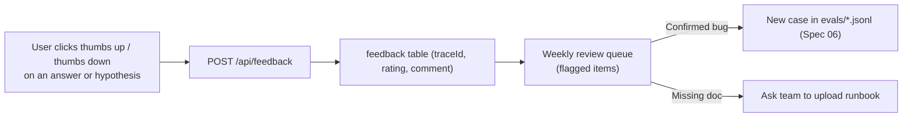

# Spec 09: Feedback, Audit Trail & Observability

**Status:** Planned

---

## 1. Problem

The database schema already has a `feedback` table (rating `helpful` / `flagged`, comment, `traceId`) and an `audit_events` table, but **no code writes to either**. There's also no tracing, so when an answer is wrong we can't see which tool returned what, which prompt was used or how long each step took. Operators can't report bad answers, and we can't learn from them.

This spec covers three connected pieces:
1. **Feedback:** let users rate answers, and turn bad answers into test cases.
2. **Audit trail:** record every important action for accountability.
3. **Tracing and metrics:** see inside each graph run.

---

## 2. Feedback Loop

### 2.1 Capture
- Every assistant answer, hypothesis list and postmortem gets **Helpful** and **Flag** buttons in the chat UI (`CitationCards`, `IncidentHypothesisPanel`, `PostmortemArtifactCard`).
- **Flag** opens a short reason picker: wrong answer, wrong citation, missing information, unsafe action, other. Plus an optional comment.
- Each graph run gets a `traceId`, returned in API responses and stored with the feedback, so a flag links to the exact run.

### 2.2 API
| Endpoint | Role | Purpose |
| :--- | :--- | :--- |
| `POST /api/feedback` | `viewer+` | Save a rating for a `traceId`. One rating per user per trace; a second rating updates the first. |
| `GET /api/feedback?rating=flagged` | `lead+` | Review queue for flagged answers, with the question, answer and citations. |

### 2.3 Turning feedback into improvements
- A lead reviews flagged items weekly.
- Confirmed model or retrieval mistakes become new cases in the evaluation dataset ([Spec 06](./06-evaluation-harness.md)), so the same mistake is caught automatically next time.
- "Missing information" flags show which runbooks teams need to write.

---

## 3. Audit Trail

Write a row to `audit_events` (`orgId`, `actorId`, `event`, `detail`) for:

| Event name | Trigger |
| :--- | :--- |
| `incident.created` | `POST /api/incidents` |
| `approval.decided` | Approve or reject, including the action payload snapshot |
| `action.executed` | `executeAction` finished, including the result (for example the GitHub issue URL) |
| `action.failed` | External action failed |
| `github.connected` / `github.disconnected` | OAuth link changes |
| `service.upserted` | Add or edit a service |
| `document.uploaded` / `document.deleted` | Runbook changes |
| `member.role_changed` | RBAC changes |

Add `GET /api/audit` (`admin` only) and an **Audit log** section in Settings so admins can answer "who approved this rollback, and when?".

The audit table is **append-only**: the app never updates or deletes rows. RLS keeps each org's log private.

---

## 4. Tracing

1. **What to trace:** each graph run is one trace. Each node, tool call and LLM call is a span with timing, input size, output size, model name and token counts.
2. **Tool choice:** LangSmith works with LangGraph with almost no code (environment variables only). OpenTelemetry is the vendor-neutral option if you'd rather send traces to Grafana, Honeycomb or similar. Pick one; LangSmith is the faster start.
3. **Privacy:** don't send customer runbook text or log contents to a third-party tracing service without the customer's consent. Offer a setting to send only metadata (timings, token counts, tool names).
4. **Linking:** use the same `traceId` from feedback in the tracing tool, so a flagged answer opens the full trace directly.

---

## 5. Metrics Dashboard

Extend the existing Runbooks & Usage view with:

| Metric | Source |
| :--- | :--- |
| Spend this month vs budget, by graph mode and by model | `model_usage` |
| p50 / p95 latency per mode | `model_usage.latencyMs` and trace spans |
| Helpful vs flagged rate over time | `feedback` |
| Grounding pass rate (from `verifyGrounding`) | Graph state, stored per run |
| Approval stats: time to decision, approve vs reject rate | `approvals` |
| Mean time to resolve incidents | `incidents.openedAt` to `resolvedAt` |

---

## 6. Non-goals
- Real-time alerting on Vigil's own health (use your hosting provider's monitoring).
- User analytics or product tracking.

## 7. Failure Cases

| Failure | Expected behavior |
| :--- | :--- |
| Tracing service unavailable | Graph runs continue normally. Tracing errors are logged and never block a user request. |
| Feedback for a trace in another org | `404`. RLS blocks the write. |
| Audit write fails | The main action still completes, but the failure is logged loudly. Retry the audit write in the background. |

## 8. Acceptance Criteria
- [ ] Users can mark any answer as helpful or flagged, and the rating is stored with its `traceId`.
- [ ] Leads can see a list of flagged answers with the full question, answer and citations.
- [ ] Every event in section 3 writes an `audit_events` row (covered by tests).
- [ ] Admins can view the audit log in Settings.
- [ ] A graph run produces a trace showing every node, tool and LLM call with timings and token counts.
- [ ] The usage dashboard shows spend by mode and the helpful/flagged rate.
