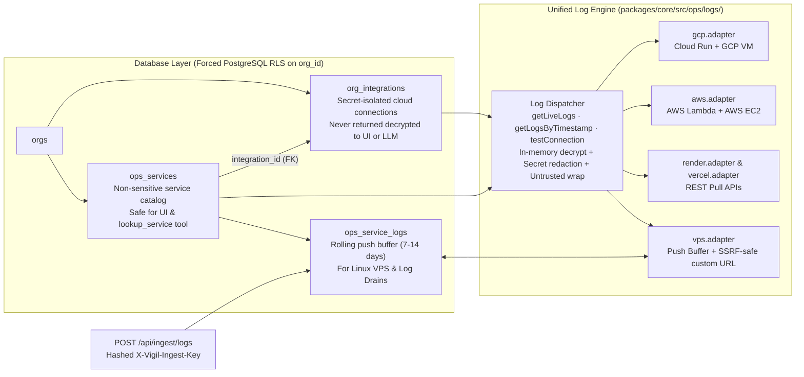
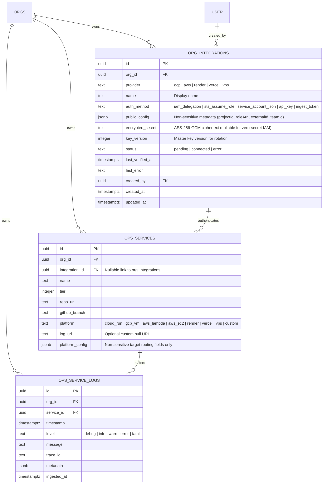
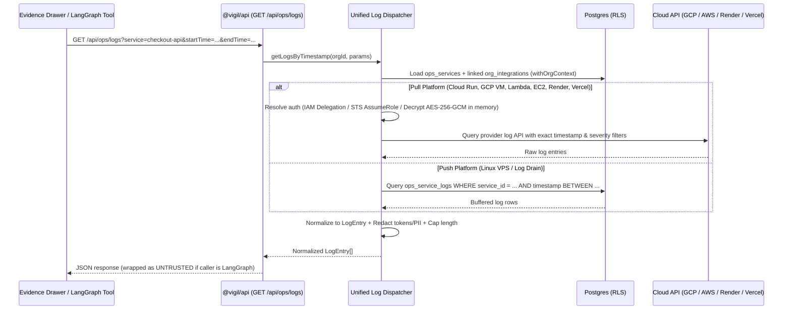
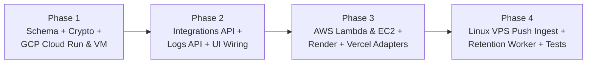

# Spec 12: Multi-Cloud Integrations, Consistent Database Design & Live Logs

**Status:** Planned (Foundation for multi-tenant cloud logging across all platforms)
**Extends:** [Spec 03: Multi-Platform Live Logs & `logUrl` Integration](./03-live-logs-and-platform-adapters.md)
**Depends on:** [Spec 07: Security & Threat Model](./07-security-and-threat-model.md)

---

## 1. Overview & Supported Platforms

Vigil must retrieve live log tails (`getLiveLogs`) and timestamp-bounded logs (`getLogsByTimestamp`) across **any customer's cloud infrastructure** — not just the platform operator's own environment — while maintaining a single, consistent database design and strong credential isolation.

This specification covers all **7 target runtime platforms** under one unified architecture:

| Platform Identifier | Cloud / Environment | Log Retrieval Model |
| :--- | :--- | :--- |
| **`cloud_run`** | Google Cloud Run (Serverless) | Pull — Google Cloud Logging API (`cloud_run_revision`) |
| **`gcp_vm`** | Google Cloud Compute Engine (GCP VPS) | Pull — Google Cloud Logging API (`gce_instance` via Ops Agent) |
| **`aws_lambda`** | AWS Lambda (Serverless) | Pull — AWS CloudWatch Logs (`FilterLogEvents`) |
| **`aws_ec2`** | AWS EC2 | Pull — AWS CloudWatch Logs (CloudWatch Agent log group) |
| **`render`** | Render Services | Pull — Render Logs REST API (or Push via Log Streams) |
| **`vercel`** | Vercel Projects | Pull — Vercel Deployment Events API (or Push via Log Drains) |
| **`vps`** / **`custom`** | Generic Linux VPS (DigitalOcean, Hetzner, bare-metal) or custom HTTP endpoint | Push — `POST /api/ingest/logs` into rolling buffer (`ops_service_logs`), or SSRF-checked Pull from `logUrl` |

---

## 2. Cons & Risks of the Current Design

Before changing the schema, here are the concrete architectural, security, and operational drawbacks of the current implementation in `packages/core/src/db/schema.ts`, `packages/core/src/ops/logs.ts`, and `packages/graphs/src/tools.ts`:

| # | Con / Flaw in Current Design | Impact | Where It Exists Today |
| :--- | :--- | :--- | :--- |
| **1** | **Global server `.env` credentials only** (`GCP_ACCESS_TOKEN`, `RENDER_API_KEY`, `VERCEL_TOKEN`, `AWS_CLOUDWATCH_TOKEN`) | Completely single-tenant. External organizations that sign up on Vigil cannot connect their own GCP, AWS, Render, or Vercel accounts at all. | `packages/core/src/ops/logs.ts` |
| **2** | **Short-lived raw GCP access tokens** | `GCP_ACCESS_TOKEN` minted by `gcloud auth print-access-token` expires every **60 minutes**, breaking live logs silently unless manually rotated. | `packages/core/src/ops/logs.ts` (`fetchCloudRunLogs`) |
| **3** | **Severe secret-leak risk in `ops_services.platform_config`** | `GET /api/ops/services` returns the entire `ops_services` row directly to the browser (including `viewer` roles). Worse, the LangGraph tool `lookup_service` runs `JSON.stringify(rows)` directly into the LLM prompt. Putting *any* API key or Service Account JSON inside `ops_services` leaks customer secrets straight to browser DevTools and external LLM providers. | `apps/api/src/controllers/ops.controller.ts` & `packages/graphs/src/tools.ts` |
| **4** | **Credential duplication across services** | A team with 6 Cloud Run services and 2 GCP VMs in the same project would have to configure and rotate credentials 8 separate times if credentials lived on `ops_services`. | `packages/core/src/db/schema.ts` (`ops_services`) |
| **5** | **Missing Cloud Run `httpRequest` & region filtering** | Cloud Run writes HTTP 500/502/504 errors into `entry.httpRequest` with empty `textPayload` and `jsonPayload`. Currently those entries degrade to `"Cloud Run log entry"`, losing the exact HTTP method, path, status code, and latency. Region (`resource.labels.location`) is also not filtered. | `packages/core/src/ops/logs.ts` (`fetchCloudRunLogs`) |
| **6** | **No safe pattern for generic Linux VPS / GCP VMs** | Generic VPS machines (DigitalOcean, Hetzner, bare-metal Linux) have no managed cloud log API. Asking customers for SSH private keys is a huge security risk and operational burden. | Missing entirely |
| **7** | **No exact timestamp-window queries (`getLogsByTimestamp`)** | `fetchLogs` only supports `sinceMinutes` relative to `now`. During post-deploy triage or postmortem drafting, engineers and the LangGraph agent need exact `[startTime, endTime]` windows (e.g., 5 minutes before to 15 minutes after a bad deploy SHA). | `packages/core/src/ops/logs.ts` |
| **8** | **Monolithic file & missing SSRF protection** | All 6 platform implementations live in one 534-line `logs.ts` file with inconsistent query shapes, no `testConnection` contract, and no blocklist preventing a custom `logUrl` from hitting internal addresses (`127.0.0.1`, `169.254.169.254`). | `packages/core/src/ops/logs.ts` |

---

## 3. Unified Architecture & Diagrams

### 3.1 Core Principle: Separate Cloud Connections from Service Targets

Credentials belong to a **Cloud Account Integration** (`org_integrations`), while `ops_services` stores **only non-sensitive routing identifiers** (`projectId`, `serviceName`, `region`, `logGroupName`, `serviceId`) plus a foreign key `integration_id` pointing to `org_integrations`.

### 3.2 Entity-Relationship Diagram

### 3.3 Pull vs. Push Execution Flows

---

## 4. Consistent Database Schema Specification

All new tables live in a dedicated schema file **`packages/core/src/db/integrations-schema.ts`** (re-exported from `packages/core/src/db/schema.ts`, mirroring `auth-schema.ts` and `chat-schema.ts`). Every table enforces `ENABLE ROW LEVEL SECURITY` and `FORCE ROW LEVEL SECURITY` scoped to `org_id`.

### 4.1 `org_integrations`

| Column | Type | Nullable | Description |
| :--- | :--- | :--- | :--- |
| **`id`** | `uuid` PK | No | Primary identifier |
| **`org_id`** | `uuid` FK → `orgs.id` (cascade) | No | Tenant isolation key (Forced RLS) |
| **`provider`** | `enum` (`gcp`, `aws`, `render`, `vercel`, `vps`) | No | Cloud provider family |
| **`name`** | `text` | No | Operator-chosen label (e.g., `"GCP Prod"`, `"AWS EU-West"`) |
| **`auth_method`** | `enum` (`iam_delegation`, `sts_assume_role`, `service_account_json`, `api_key`, `ingest_token`) | No | Strategy used by the adapter to authenticate |
| **`public_config`** | `jsonb` | No | Safe, displayable configuration (e.g., `projectId`, `roleArn`, `externalId`, `region`, `ownerId`, `teamId`, `tokenPrefix`) |
| **`encrypted_secret`** | `text` | Yes | AES-256-GCM payload (`iv:authTag:ciphertext`) for stored secrets, or SHA-256 hash for `ingest_token`. **`NULL` for GCP Cross-Project IAM and AWS STS `AssumeRole`.** |
| **`key_version`** | `integer` | No (default `1`) | Tracks which `CREDENTIALS_ENCRYPTION_KEY` encrypted the row |
| **`status`** | `enum` (`pending`, `connected`, `error`) | No (default `pending`) | Updated on creation and on every `testConnection` / runtime auth error |
| **`last_verified_at`** | `timestamptz` | Yes | Last successful connectivity check |
| **`last_error`** | `text` | Yes | Safe, non-sensitive error message (e.g., `"Permission denied: grant roles/logging.viewer"`) |
| **`created_by`** | `uuid` FK → `user.id` (set null) | Yes | Audit owner |
| **`created_at` / `updated_at`** | `timestamptz` | No | Standard timestamps |

**Indexes:**
- `org_integrations_org_provider_idx` on `(org_id, provider)`
- Unique index `org_integrations_org_name_uq` on `(org_id, name)`

### 4.2 `ops_services` Updates (Backwards-Compatible)

- Add nullable **`integration_id`** (`uuid` FK → `org_integrations.id`, `onDelete: "set null"`).
- Extend `DEPLOYMENT_PLATFORMS` to: `cloud_run`, `gcp_vm`, `aws_lambda`, `aws_ec2`, `render`, `vercel`, `vps`, `custom`.
- Non-sensitive `platform_config` contract per platform:

| Platform | Required / Optional Fields in `ops_services.platform_config` |
| :--- | :--- |
| **`cloud_run`** | `projectId`, `serviceName`, `region` (optional, maps to `resource.labels.location`) |
| **`gcp_vm`** | `projectId`, `instanceName` (or `instanceId`), `zone`, `logName` (optional filter) |
| **`aws_lambda`** | `region`, `functionName`, `logGroupName` (defaults to `/aws/lambda/<functionName>`) |
| **`aws_ec2`** | `region`, `logGroupName`, `instanceId` (optional log stream filter) |
| **`render`** | `serviceId`, `ownerId` (optional) |
| **`vercel`** | `projectId`, `teamId` (optional), `deploymentId` (optional) |
| **`vps`** | `hostname`, `unitName` (optional systemd/container tag) |
| **`custom`** | `logUrl` (validated against SSRF blocklist) |

### 4.3 `ops_service_logs` (Push Ingestion Buffer)

| Column | Type | Nullable | Description |
| :--- | :--- | :--- | :--- |
| **`id`** | `uuid` PK | No | Log entry ID |
| **`org_id`** | `uuid` FK → `orgs.id` (cascade) | No | Forced RLS tenant key |
| **`service_id`** | `uuid` FK → `ops_services.id` (cascade) | No | Target service in `ops_services` |
| **`timestamp`** | `timestamptz` | No | Event timestamp emitted by the host/app |
| **`level`** | `enum` (`debug`, `info`, `warn`, `error`, `fatal`) | No | Normalized severity |
| **`message`** | `text` | No | Redacted log message (capped at 4,000 chars) |
| **`trace_id`** | `text` | Yes | Optional distributed trace or request ID |
| **`metadata`** | `jsonb` | Yes | Optional structured fields (`host`, `unit`, `statusCode`, `latencyMs`) |
| **`ingested_at`** | `timestamptz` | No | Server receipt time (used by retention cleanup job) |

**Indexes:**
- `ops_service_logs_org_svc_time_idx` on `(org_id, service_id, timestamp DESC)`
- `ops_service_logs_ingested_idx` on `(ingested_at)` for fast daily retention pruning (delete rows older than 14 days).

---

## 5. Multi-Tenant Authentication & Security Matrix

Every provider defaults to **least-privilege, zero-stored-secret delegation** wherever the cloud vendor supports it, falling back to **AES-256-GCM encrypted credentials** only when required:

| Provider | Platforms | Primary Auth (Recommended) | Fallback Auth | Secret Stored in DB? |
| :--- | :--- | :--- | :--- | :--- |
| **GCP** | `cloud_run`, `gcp_vm` | **Cross-Project IAM (`iam_delegation`):** User grants Vigil's single Service Account **`roles/logging.viewer`** (read-only) on their GCP project via a 1-line `gcloud` command shown in the UI. | Encrypted read-only Service Account JSON (`service_account_json`) | **No** for IAM delegation; AES-256-GCM if JSON uploaded |
| **AWS** | `aws_lambda`, `aws_ec2` | **Cross-Account IAM Role (`sts_assume_role`):** User creates a read-only IAM Role (`logs:FilterLogEvents`, `logs:DescribeLogStreams`) trusting Vigil's AWS account + a unique per-org `ExternalId`. AWS STS issues 15-minute temporary credentials on demand. | Encrypted read-only IAM Access Key (`api_key`) | **No** for STS `AssumeRole` (only Role ARN + ExternalId) |
| **Render** | `render` | **API Key (`api_key`):** Read-only Render API key stored encrypted. | Push Log Stream → `POST /api/ingest/logs` | AES-256-GCM ciphertext |
| **Vercel** | `vercel` | **Bearer Token (`api_key`):** Scoped Vercel token stored encrypted. | Vercel Log Drain → `POST /api/ingest/logs` | AES-256-GCM ciphertext (or SHA-256 hash for drain) |
| **Linux VPS** | `vps`, `custom` | **Ingest Token (`ingest_token`):** Per-org push token generated once, stored as **SHA-256 hash**, used by Fluent Bit / Vector / `journald` forwarder to push to `POST /api/ingest/logs`. | SSRF-validated custom `logUrl` + optional encrypted Bearer header | **Hashed only** (never recoverable) |

### Mandatory Security Guardrails
1. **Master Key Separation:** `CREDENTIALS_ENCRYPTION_KEY` (32-byte base64/hex) lives only in environment variables / secret manager — never in Postgres.
2. **Write-Only Secrets API:** `GET /api/ops/integrations` returns `id`, `provider`, `name`, `authMethod`, `publicConfig`, `status`, `lastVerifiedAt`, and `lastError` — **never** `encrypted_secret` or decrypted credentials.
3. **RBAC:** Only `admin` and `lead` roles may create, rotate, or delete `org_integrations`. `viewer` and `responder` roles can view masked integration status and query logs.
4. **LLM Prompt Isolation:** `lookup_service` reads only `ops_services` (which holds zero secrets). All log lines passed to LangGraph tools are redacted for bearer tokens/API keys/PII, length-capped, and wrapped inside the untrusted-data envelope ([Spec 07](./07-security-and-threat-model.md)).
5. **SSRF Protection:** Any custom `logUrl` resolves DNS and rejects loopback (`127.0.0.0/8`, `::1`), RFC-1918 private networks (`10/8`, `172.16/12`, `192.168/16`), and cloud metadata IPs (`169.254.169.254`).

---

## 6. Unified Log Adapter Contract (`packages/core/src/ops/logs/`)

Refactor the monolithic `packages/core/src/ops/logs.ts` into a modular adapter directory where every provider implements one uniform contract:

| Module | Responsibility |
| :--- | :--- |
| **`packages/core/src/security/crypto.ts`** | AES-256-GCM `encryptSecret` / `decryptSecret` + SHA-256 `hashIngestToken` + secret redaction utility for log messages. |
| **`packages/core/src/ops/logs/types.ts`** | Normalized `LogEntry`, `LiveLogsQuery`, `TimestampLogsQuery`, `TestConnectionResult`, and the `LogProviderAdapter` interface (`getLiveLogs`, `getLogsByTimestamp`, `testConnection`). |
| **`packages/core/src/ops/logs/adapters/gcp.adapter.ts`** | Uses `google-auth-library` (supporting Vigil's ADC/SA for `iam_delegation` and decrypted per-org SA JSON). Handles both `cloud_run` (`cloud_run_revision`) and `gcp_vm` (`gce_instance`), parses `httpRequest` (method, URL, status, latency), and filters by `region`/`zone`, `severity`, `keyword`, and exact `[startTime, endTime]`. |
| **`packages/core/src/ops/logs/adapters/aws.adapter.ts`** | Uses `@aws-sdk/client-sts` (`AssumeRole` with `ExternalId`) + `@aws-sdk/client-cloudwatch-logs` (`FilterLogEvents`). Handles both `aws_lambda` and `aws_ec2` over live and timestamp windows. |
| **`packages/core/src/ops/logs/adapters/render.adapter.ts`** | Queries Render Logs REST API with exact `startTime` / `endTime`, severity, and text filters. |
| **`packages/core/src/ops/logs/adapters/vercel.adapter.ts`** | Queries Vercel Deployment Events / Runtime Logs API with `since` / `until` timestamps. |
| **`packages/core/src/ops/logs/adapters/vps.adapter.ts`** | Queries `ops_service_logs` (push buffer) for `vps` services, or fetches SSRF-validated `custom` `logUrl`. |
| **`packages/core/src/ops/logs/index.ts`** | Single public API exporting `getLiveLogs`, `getLogsByTimestamp`, `testServiceLogsConnection`, and `ingestServiceLogs` (plus backwards-compatible aliases `fetchLogs` / `fetchLiveLogs` for existing LangGraph tools). |

---

## 7. Phased Rollout Plan

### Phase 1: Foundation + Google Cloud Run & GCP VM *(Start Here)*
- **Database:** Create `packages/core/src/db/integrations-schema.ts` (`org_integrations`, `ops_service_logs`) and add `integrationId` + `gcp_vm`/`vps` enum values to `ops_services` (user generates & applies migration with Forced RLS).
- **Security:** Implement `packages/core/src/security/crypto.ts` (AES-256-GCM encryption + log secret redaction).
- **Adapter Framework + GCP:** Split `packages/core/src/ops/logs/` into the modular adapter interface and implement `gcp.adapter.ts` using `google-auth-library` with full `getLiveLogs`, `getLogsByTimestamp`, `testConnection`, `region` filtering, and `httpRequest` 5xx formatting.
- **Outcome:** Immediately verify live logs and timestamp-range logs against your deployed Google Cloud Run apps (and any GCP Compute Engine VM with Ops Agent).

### Phase 2: Backend API, LangGraph Tools & Frontend Wiring
- **API Endpoints (`apps/api`):**
  - `GET /api/ops/integrations` — List org integrations (masked metadata only).
  - `POST /api/ops/integrations` — Create integration (`admin`/`lead`), encrypt secret if present, verify immediately.
  - `POST /api/ops/integrations/:id/test` — Re-verify connectivity and update `status` / `last_verified_at`.
  - `DELETE /api/ops/integrations/:id` — Revoke and delete integration.
  - `GET /api/ops/logs` — Supports both live mode (`?service=X&live=true&lines=30`) and timestamp range (`?service=X&startTime=...&endTime=...&level=error&keyword=...`).
  - `POST /api/ops/services/test-logs` — Real connectivity check for the Add Service modal.
- **LangGraph (`packages/graphs/src/tools.ts`):** Add `get_logs_by_timestamp` tool alongside `fetch_live_logs` and wrap all returned log lines in the untrusted-data envelope.
- **Frontend (`apps/web`):**
  - Add an **Integrations** tab in `SettingsView.tsx` where admins connect cloud accounts (including the copy-paste 1-line `gcloud` IAM grant for GCP).
  - Update `ServicePlatformModal.tsx` to select a connected `integrationId`, choose platform (`Cloud Run`, `GCP VM`, `Lambda`, `EC2`, `Render`, `Vercel`, `VPS`), and run real **Test connection**.
  - Wire `VigilCopilotChat.tsx` + `EvidenceDrawer.tsx` (**Logs** tab) with live polling and timestamp-range filtering.

### Phase 3: AWS (Lambda & EC2), Render & Vercel Adapters
- Implement `aws.adapter.ts` with `@aws-sdk/client-sts` (`AssumeRole` + `ExternalId`) and `@aws-sdk/client-cloudwatch-logs` (`FilterLogEvents`), plus copy-paste IAM Trust Policy instructions in the UI.
- Migrate `render.adapter.ts` and `vercel.adapter.ts` to read decrypted credentials from `org_integrations` instead of global `.env` variables, with full `startTime`/`endTime` support.

### Phase 4: Generic Linux VPS Push Ingestion, Retention & Verification
- Implement `POST /api/ingest/logs` (batch JSON log ingestion authenticated by SHA-256 hashed `X-Vigil-Ingest-Key`, rate-limited per org).
- Implement `vps.adapter.ts` querying `ops_service_logs` and SSRF-guarded `custom` `logUrl`.
- Add a BullMQ repeatable cleanup job in `@vigil/worker` pruning `ops_service_logs` older than 14 days.
- Add automated unit and integration tests for AES-256-GCM round-trips, RLS isolation on `org_integrations`/`ops_service_logs`, SSRF blocking, secret redaction, and `gcp.adapter` `httpRequest` parsing.

---

## 8. Non-Goals
- Acting as a long-term petabyte log warehouse (pull providers query logs on demand; `ops_service_logs` is strictly a short-term rolling buffer for VPS/drains).
- SSH-based log tailing or storing customer SSH private keys.
- Ingesting Prometheus metrics or OpenTelemetry trace spans (logs only in this spec).

## 9. Failure Cases

| Failure | Expected Behavior |
| :--- | :--- |
| Cloud credentials revoked or IAM role removed | Adapter returns structured `auth_error`; `org_integrations.status` updates to `"error"` with `last_error` populated; UI prompts admin to reconnect/re-grant. |
| `CREDENTIALS_ENCRYPTION_KEY` missing when saving/reading an encrypted integration | Fails fast with a clear server configuration error; never writes plaintext secrets to Postgres. |
| Provider API times out (> 8 seconds) | Request aborts cleanly and returns a timeout message so the Evidence Drawer and LangGraph agent never hang. |
| `custom` `logUrl` targets localhost or cloud metadata IP (`169.254.169.254`) | Rejected immediately at validation and request time with `400 Bad Request`. |
| Unauthenticated or invalid `X-Vigil-Ingest-Key` on `POST /api/ingest/logs` | Rejected with `401 Unauthorized`; nothing written to `ops_service_logs`. |
| VPS log shipper floods `POST /api/ingest/logs` | Per-org rate limiter returns `429 Too Many Requests` and caps batch size (max 500 lines/request). |

## 10. Acceptance Criteria
- [ ] `org_integrations` and `ops_service_logs` tables exist with Forced PostgreSQL RLS on `org_id`, and `ops_services` links via `integration_id` with zero secrets stored in `ops_services`.
- [ ] `encryptSecret` / `decryptSecret` uses AES-256-GCM, and `GET /api/ops/integrations` never returns raw secrets (verified by test).
- [ ] `getLiveLogs` and `getLogsByTimestamp` return real stdout/stderr AND formatted `httpRequest` (5xx) entries from a live Google Cloud Run service via `gcp.adapter.ts`.
- [ ] `GET /api/ops/logs` supports both live tail (`live=true`) and explicit `startTime`/`endTime` queries, and renders inside the Evidence Drawer **Logs** tab.
- [ ] `POST /api/ops/services/test-logs` performs a real backend connectivity check in `ServicePlatformModal.tsx`.
- [ ] `aws.adapter.ts` queries both Lambda and EC2 CloudWatch log groups via STS `AssumeRole` with `ExternalId`.
- [ ] `render.adapter.ts`, `vercel.adapter.ts`, and `vps.adapter.ts` (`POST /api/ingest/logs`) all satisfy the same `LogProviderAdapter` interface.
- [ ] Log entries returned to LangGraph tools are redacted for secrets, length-capped, and wrapped as untrusted data.
